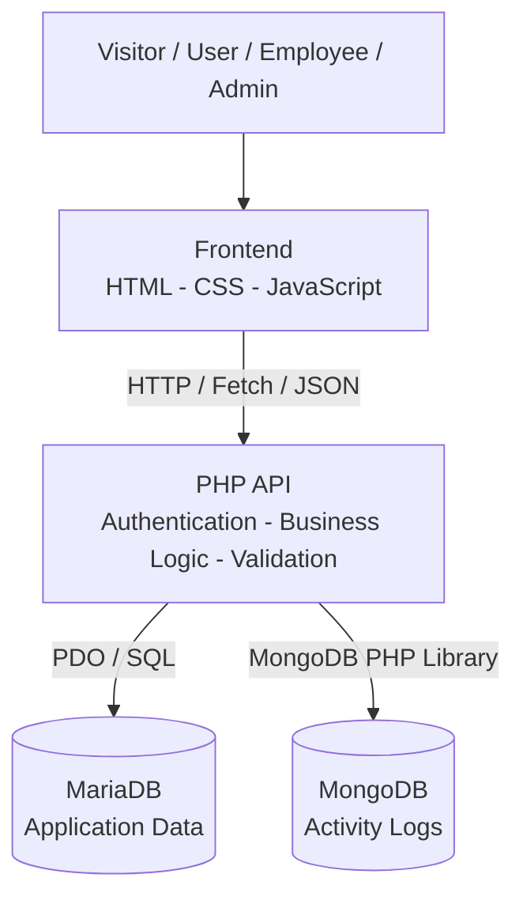
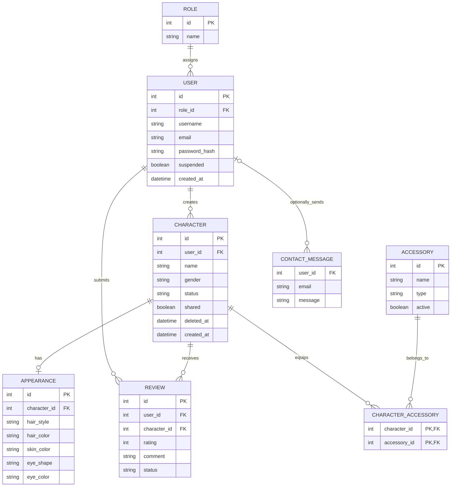
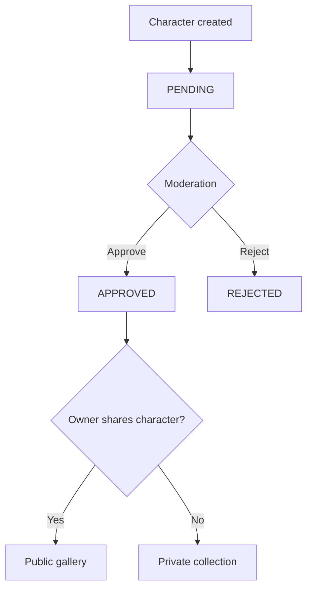
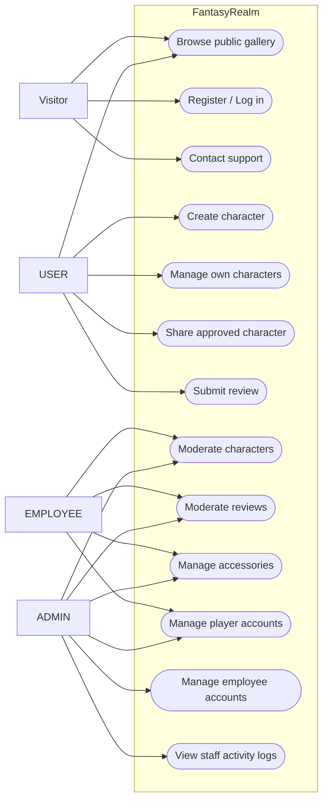
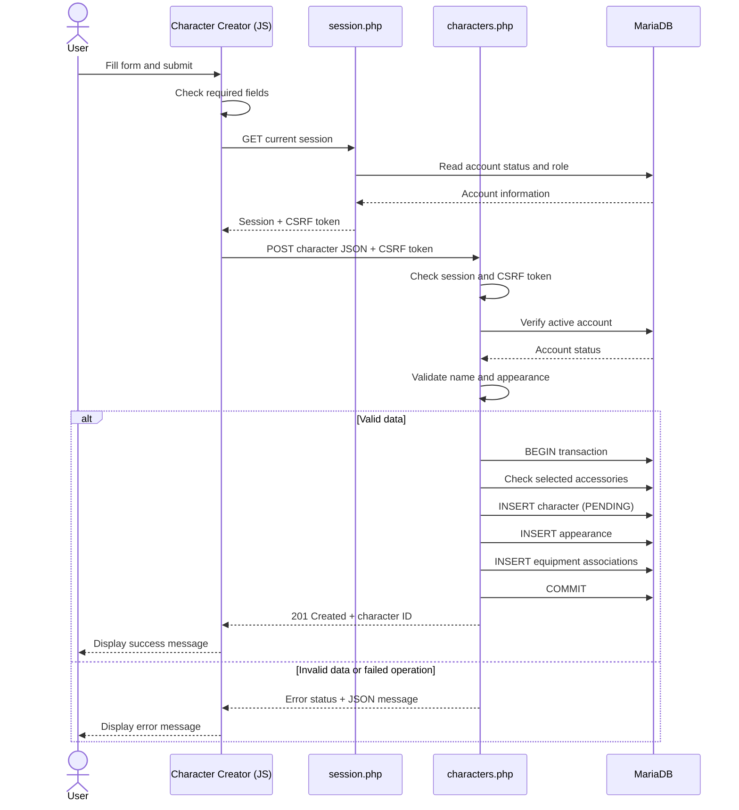
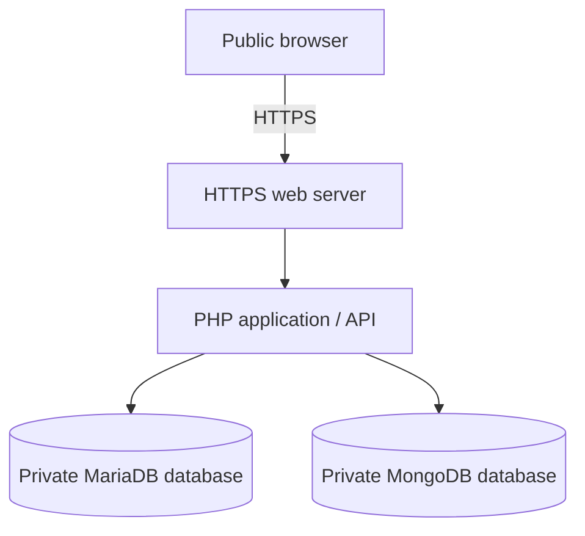

# FantasyRealm — Technical Documentation

**Project:** FantasyRealm  
**Training:** Studi — Développeur Web et Web Mobile (DWWM)  
**Date:** 01/11/2026  
**Development environment:** Windows / XAMPP  
**Application status:** Functional locally; public deployment planned  
**Repository:** https://github.com/IbbiBoy2/FantasyRealm  
**Reviewed branch:** `feature/user-dashboard`

---

## 1. Project Overview

FantasyRealm is a web application for creating, managing and sharing fantasy characters.

Users can customize characters, equip accessories, manage their collections, publish approved characters and interact with community content.

The application also includes separate interfaces for employee moderation and administrator management.

### Main objectives

- Develop a responsive web interface.
- Implement authentication and user account management.
- Create a PHP API for communication with the frontend.
- Store application data in a relational database.
- Use MongoDB for staff activity logging.
- Implement access restrictions according to user roles.
- Apply security measures to sensitive operations.
- Prepare the application for future public deployment.

The application is developed for the Studi DWWM examination and currently runs locally using XAMPP.

## 2. Technical Choices

| Technology | Purpose | Reason for choice |
|---|---|---|
| HTML5 | Page structure | Semantic elements and accessibility |
| CSS3 | Presentation and responsive layouts | Customizable interface without a CSS framework |
| JavaScript | Dynamic functionality | DOM interaction and API requests |
| Fetch API | Frontend/backend communication | Native asynchronous HTTP requests |
| PHP 8.2 | Backend application logic | Compatible with XAMPP and relational databases |
| PDO | SQL database access | Prepared statements and exception handling |
| MariaDB | Relational application data | Tables, constraints, relationships and transactions |
| MongoDB | Staff activity logs | Document-based event storage |
| Composer | PHP dependencies | Dependency installation and management |
| Git / GitHub | Version control | Source history and collaboration |
| XAMPP | Local hosting | Apache, PHP and MariaDB in a local environment |

### Architecture decisions

**No frontend framework:** The project uses vanilla JavaScript to keep the frontend simple and provide direct control over HTML, CSS and DOM behavior.

**PHP API:** The frontend communicates with separate PHP endpoints using JSON, separating interface behavior from server-side processing.

**Relational database:** MariaDB stores structured data with relationships between users, characters, reviews and accessories.

**Document database:** MongoDB stores activity events independently from the main relational database.

**Server-side security:** Authentication, authorization and validation are performed in PHP rather than relying only on JavaScript.

## 3. Development Environment

### Hardware and operating system

Development is performed on a Windows computer.

### Main software

- Visual Studio Code
- XAMPP
- Apache
- PHP 8.2
- MariaDB / MySQL
- MongoDB Community Server
- Composer
- Git
- Google Chrome

### Local project directory

```text
C:\xampp\htdocs\FantasyRealm
```

### Local application URL

```text
http://localhost/FantasyRealm/Frontend/Html/index.html
```

### Development process

1. Write frontend HTML, CSS and JavaScript in Visual Studio Code.
2. Implement PHP backend endpoints.
3. Create and modify MariaDB tables using SQL and phpMyAdmin.
4. Configure MongoDB activity logging.
5. Test the website through Apache and Chrome.
6. Inspect network requests and errors using browser developer tools.
7. Commit changes using Git.
8. Push reviewed changes to GitHub.

The application is tested locally before changes are included in a release.

## 4. Application Architecture

FantasyRealm follows a layered client-server architecture.

### Architecture diagram



### Frontend layer

Located in `Frontend/`, this layer handles:

- Page display and navigation
- Forms
- Character previews
- User interaction
- Validation feedback
- API calls
- Dynamic character and gallery rendering

The frontend does not connect directly to MariaDB or MongoDB.

### Backend layer

Located in `Backend/api/`, this layer handles:

- Registration and authentication
- Account verification
- Character creation and management
- Character and review moderation
- Employee and administrator operations
- Data validation
- JSON responses
- Activity logging

PHP is responsible for validating requests and enforcing access restrictions.

### Data layer

**MariaDB** stores application records.

**MongoDB** stores staff activity events.

These databases have different responsibilities and are accessed by the backend.

### Example request flow

1. A user submits the Character Creator form.
2. JavaScript collects the selected values.
3. JavaScript retrieves the session's CSRF token.
4. A JSON POST request is sent to the PHP API.
5. PHP verifies authentication, the CSRF token and submitted data.
6. PHP uses PDO to write to MariaDB.
7. The API returns a JSON response.
8. JavaScript displays a success or error message.

## 5. Project Structure

```text
FantasyRealm/
│
├── Frontend/
│   ├── Html/
│   │   ├── index.html
│   │   ├── register.html
│   │   ├── login.html
│   │   ├── create-character.html
│   │   ├── character-gallery.html
│   │   ├── character.html
│   │   ├── dashboard.html
│   │   ├── employee-dashboard.html
│   │   ├── admin-dashboard.html
│   │   └── ...
│   │
│   ├── Css/
│   ├── js/
│   └── assets/
│
├── Backend/
│   ├── api/
│   ├── config/
│   │   ├── database.php
│   │   ├── security.php
│   │   └── activity-logger.php
│   │
│   ├── Database/
│   │   ├── shema.sql
│   │   └── seed.sql
│   │
│   ├── composer.json
│   └── composer.lock
│
├── docs/
├── .gitignore
└── README.md
```

The `docs/` directory is the proposed location for project documentation. It may need to be created locally.

## 6. Database Design — MCD

### 6.1 Conceptual data model

The main relational entities are:

| Entity | Description |
|---|---|
| ROLE | Defines an application's account role |
| USER | Stores registered accounts |
| CHARACTER | Stores created characters |
| APPEARANCE | Stores character customization |
| ACCESSORY | Stores available equipment |
| CHARACTER_ACCESSORY | Associates characters with selected equipment |
| REVIEW | Stores ratings and comments |
| CONTACT_MESSAGE | Stores contact form submissions |

### 6.2 MCD / Entity relationship diagram



**Model scope:** This diagram combines relationships from the committed SQL schema with the contact-message functionality used by the current PHP API. It is a logical overview, not a verified export of every field in the working database.

### 6.3 Cardinalities

| Relationship | Cardinality |
|---|---|
| Role → Users | One role can be assigned to many users; each user has one role |
| User → Characters | One user can create multiple characters |
| Character → Appearance | A character has at most one appearance record in the relational model |
| User → Reviews | One user can submit multiple reviews |
| Character → Reviews | One character can receive multiple reviews |
| Character ↔ Accessories | Many-to-many relationship through `character_accessories` |
| User → Contact Messages | A registered user can submit messages; anonymous messages are also supported |

### 6.4 Physical database

The original SQL schema contains these main tables:

- `roles`
- `users`
- `characters`
- `appearances`
- `accessories`
- `character_accessories`
- `reviews`

The current API also uses newer structures, such as `contact_messages`, and newer fields, such as `characters.rejection_reason`.

**Important:** The committed `Backend/Database/shema.sql` file is outdated compared with the working application. Before submitting a final physical database diagram or deploying publicly, export and verify the complete current database schema.

### 6.5 Database integrity

The database uses:

- Primary keys
- Foreign keys
- Unique constraints
- Associative tables
- SQL transactions

For example, character creation uses a transaction to save the character, its appearance and selected equipment together.

If an operation fails before commit, the transaction can be rolled back.

## 7. Character and Review Lifecycle

### Character workflow

A newly created character begins with:

```text
status = PENDING
shared = false
```

An authorized employee or administrator can approve or reject the character.



A character appears in the public gallery only when it is approved and shared.

### Review workflow

A user submits a rating and comment.

The review begins as `PENDING`. An authorized staff member can approve or reject it.

Only approved reviews are returned for public display by the reviews API.

### Deletion

The application supports soft deletion and restoration of characters, as well as permanent deletion.

The `deleted_at` field is used for soft-deletion state.

## 8. Use Case Diagram

### Actors

| Actor | Responsibilities |
|---|---|
| Visitor | Browse public content, register, log in, contact support |
| USER | Create and manage characters, share approved characters, submit reviews |
| EMPLOYEE | Moderate characters and reviews, manage accessories and player accounts |
| ADMIN | Manage employees, access administrative information and perform employee functions |

### Use case diagram



This is a use-case overview represented with a Mermaid flowchart. Backend role checks determine which actions an account can actually perform.

## 9. Sequence Diagram

### Use case: Create a character

The following diagram describes the character creation request.



### Technical explanation

The frontend is responsible for collecting user input and displaying feedback.

The backend is responsible for authentication, validation and database operations.

The server does not trust user-supplied identifiers for account ownership; protected actions use the authenticated PHP session.

Character creation uses a SQL transaction because multiple related records must be saved consistently.

## 10. API Design

The backend uses PHP files as REST-style JSON endpoints.

### Examples

| Endpoint | Main purpose |
|---|---|
| `register.php` | Account registration |
| `login.php` | Authentication |
| `logout.php` | Logout |
| `session.php` | Retrieve session information |
| `characters.php` | Character listing and creation |
| `my-characters.php` | Retrieve the user's characters |
| `duplicate-character.php` | Duplicate a character |
| `delete-character.php` | Soft-delete a character |
| `restore-character.php` | Restore a deleted character |
| `share-character.php` | Change sharing status |
| `gallery.php` | Retrieve public characters |
| `submit-review.php` | Submit a review |
| `moderate-character.php` | Approve or reject a character |
| `moderate-review.php` | Approve or reject a review |
| `employee-dashboard.php` | Employee dashboard data |
| `admin-dashboard.php` | Administrator dashboard data |
| `admin-activity-logs.php` | Read staff activity logs |
| `contact.php` | Save contact messages |

### API communication

The frontend sends requests with `fetch()` and processes JSON responses.

Protected write operations commonly send the CSRF token in:

```http
X-CSRF-Token: <session-generated-token>
```

### HTTP status codes

| Code | Meaning |
|---|---|
| 200 | Successful request |
| 201 | Resource successfully created |
| 400 | Invalid request |
| 401 | Authentication required |
| 403 | Access forbidden |
| 404 | Resource not found |
| 409 | Resource conflict |
| 422 | Invalid submitted data |
| 500 | Internal server error |

Individual endpoints may use different codes depending on the operation.

## 11. Security

Security is implemented primarily on the PHP backend.

### 11.1 Password security

FantasyRealm uses Argon2id to hash passwords.

The `password_hash()` function creates password hashes, while `password_verify()` checks submitted passwords.

Older hashes can be upgraded to Argon2id after successful authentication.

Passwords are not stored in plaintext.

### 11.2 SQL injection protection

Database access uses PDO with prepared statements.

User-supplied values are passed separately from SQL instructions, reducing SQL injection risk.

### 11.3 XSS protection

The frontend uses safe DOM APIs such as `textContent` for many user-generated values.

HTML output must continue to be escaped appropriately wherever user content is inserted into markup.

Protection must be verified at every relevant output location.

### 11.4 CSRF protection

Protected requests use session-generated CSRF tokens.

The server compares the received token against the expected session token.

Invalid or missing tokens are rejected.

### 11.5 Session security

The shared security configuration provides:

- Cookie-only sessions
- `HttpOnly` cookies
- `SameSite=Lax`
- Secure cookies when HTTPS is detected
- Strict session mode

The login implementation regenerates the session ID after successful authentication.

Before production deployment, all session-starting endpoints should be checked for consistent security settings.

### 11.6 Role-based access control

Three roles are defined:

- `USER`
- `EMPLOYEE`
- `ADMIN`

Staff endpoints check current database roles and account suspension status.

For example, `requireAdmin()` verifies that the requester has an active administrator account.

Displaying or hiding navigation links is not treated as sufficient authorization.

### 11.7 Server-side validation

The backend validates data independently of browser controls.

Examples include:

- Required fields
- Email format
- Character names and customization choices
- Equipment identifiers
- Review ratings
- Comment lengths
- Moderation decisions
- Account authorization

### 11.8 Error handling

Application endpoints generally return structured JSON errors instead of exposing database connection details to clients.

Server-side technical logs can be used for troubleshooting.

### 11.9 Security testing

Manual testing and source-code review have covered important application behavior.

A complete security audit or penetration test has not been established by these checks alone.

## 12. MongoDB Activity Logging

MongoDB is used for staff activity records.

### Database and collection

```text
Database: fantasyrealm
Collection: activity_logs
```

### Example event structure

```json
{
  "_id": "event-identifier",
  "actor_id": 1,
  "action": "character.approved",
  "target_type": "character",
  "target_id": 12,
  "created_at": "MongoDB UTCDateTime"
}
```

This is an illustrative structure; the actual `_id` is a validated hexadecimal identifier and the timestamp is stored as a BSON date rather than a JSON string.

### Logging examples

- Character approval or rejection
- Review moderation
- Employee account changes
- Player account actions
- Accessory creation or changes

MongoDB activity records reference MariaDB entities by identifiers, without relational foreign-key enforcement between the two databases.

### Retention

The intended retention period is 365 days.

The TTL index must use the actual stored timestamp field, `created_at`.

## 13. Responsive Design and Accessibility

### Responsive design

The interface uses CSS layouts and media queries to adapt to different screen sizes.

Testing has included a 320px mobile viewport and 200% browser zoom.

### Accessibility improvements

Work completed during development includes:

- Semantic HTML structure
- Accessible form labels
- Keyboard-accessible controls
- Visible keyboard focus
- Skip-to-main-content links
- Accessible dialog behavior
- Improved text contrast
- Form status messages

These improvements support accessibility objectives but do not constitute a formal, exhaustive RGAA certification.

## 14. Development Testing

### Functional testing

Main user journeys tested during development include:

- Registration
- Login
- Character creation
- Character management
- Character moderation
- Gallery filters
- Keyboard navigation

### Security and API checks

Checks have included:

- PDO query construction
- Role-based authorization behavior
- Invalid input handling
- CSRF protection
- Selected API error responses

### Testing tools

- Google Chrome
- Chrome Developer Tools
- XAMPP
- phpMyAdmin
- Visual Studio Code
- Manual test scenarios

Detailed test results are maintained separately.

## 15. Deployment Architecture

FantasyRealm currently runs locally but is intended to be published in the future.

### Planned production architecture



The hosting provider, domain and final server configuration have not yet been selected.

### Deployment steps

1. Prepare and review a stable Git release.
2. Provision compatible PHP hosting.
3. Configure the domain and HTTPS.
4. Deploy application source files.
5. Install Composer dependencies.
6. Prepare the complete MariaDB schema.
7. Create dedicated production database users.
8. Configure MongoDB.
9. Set production environment variables.
10. Protect private application files.
11. Configure data retention and backups.
12. Test authentication, character management and staff permissions.
13. Verify responsive behavior, security and error handling.
14. Complete legal and privacy information.
15. Publish after staging verification.

### Environment configuration

The application uses these environment variables:

```dotenv
DB_HOST=YOUR_DATABASE_HOST
DB_PORT=3306
DB_NAME=fantasyrealm
DB_USER=YOUR_DATABASE_USER
DB_PASSWORD=YOUR_DATABASE_PASSWORD

MONGODB_URI=YOUR_MONGODB_CONNECTION_URI
MONGODB_DATABASE=fantasyrealm
```

Real credentials must never be committed to Git.

## 16. Current Limitations and Future Improvements

The following items should be addressed or verified before public deployment.

| Area | Current situation / next step |
|---|---|
| Database installation | Export and version the complete current MariaDB schema |
| SQL seed | Replace outdated test data and placeholder hashes |
| Production hosting | Select and configure a provider |
| HTTPS | Configure and test TLS and session cookies |
| URL configuration | Review hardcoded `/FantasyRealm/` paths |
| Filesystem security | Protect configuration and dependency files |
| Password reset | Implement private email delivery or retain a documented unavailable state |
| Session consistency | Audit all authentication-related PHP endpoints |
| Rate limiting | Review public endpoints for abuse protection |
| Backups | Configure and test recovery procedures |
| Legal documents | Update with actual hosting and operator information |
| Deployment testing | Verify all workflows in a production-like environment |

The current `forgot-password.php` endpoint deliberately returns HTTP 503 while password-reset delivery remains disabled.

## 17. Conclusion

FantasyRealm demonstrates the implementation of a dynamic web application with a custom frontend, PHP backend, relational database and MongoDB activity logging.

The project includes account management, character customization, moderation workflows, role-based administration and several application security mechanisms.

The selected technologies allow the application to run locally through XAMPP and provide a foundation for future public hosting.

The conceptual diagrams document the main relationships and workflows implemented in the reviewed source code.

**Before the final examination submission**, the MCD and physical database documentation should be reconciled with the latest MariaDB export so the submitted model accurately represents the final database.

---

**Project:** FantasyRealm  
**Training:** Studi DWWM  
**Document:** Technical Documentation  
**Version:** 1.0  
**Status:** Local implementation documented — public deployment planned